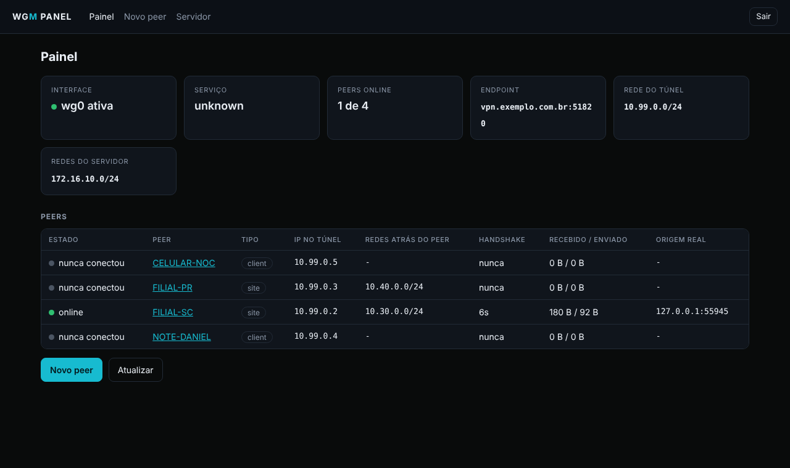

# wgm-panel

Painel web básico para o `wg-server-manager`: criar o servidor, criar e remover peers, alterar allowed address, baixar a config (.conf, QR code ou script MikroTik) e ver quem está online, com handshake e tráfego.



Leve por desenho: Python só com biblioteca padrão (nada de pip), sem JavaScript. Ele **não fica rodando**. O systemd segura a porta e só sobe o painel no primeiro acesso; depois de 10 minutos sem uso o processo encerra sozinho. Ativo usa cerca de 22 a 25 MB de RAM; parado, zero.

Toda alteração passa pelo `wg-server-manager`. As validações de conflito, os backups e o lock são os mesmos do CLI, e os dois podem ser usados juntos.

## Requisitos

- `wg-server-manager` 1.1.0 ou superior instalado em `/usr/local/sbin/wg-server-manager`
- Python 3.7+ (já vem no Debian, Ubuntu e RHEL)
- systemd
- `qrencode` (opcional, para o QR code)

## Instalação

Como root, a partir da pasta do projeto:

```bash
install -m 750 wg-server-manager.sh /usr/local/sbin/wg-server-manager
install -d -m 755 /usr/local/lib/wgm-panel
install -m 644 panel/wgm-panel.py /usr/local/lib/wgm-panel/wgm-panel.py
install -d -m 700 /etc/wgm-panel
install -m 600 panel/panel.conf.example /etc/wgm-panel/panel.conf
python3 /usr/local/lib/wgm-panel/wgm-panel.py --set-password      # mínimo 12 caracteres
install -m 644 panel/wgm-panel.socket panel/wgm-panel.service /etc/systemd/system/
systemctl daemon-reload
systemctl enable --now wgm-panel.socket
```

Confira que só o socket está ativo (o serviço sobe no primeiro acesso):

```bash
systemctl is-active wgm-panel.socket     # active
systemctl is-active wgm-panel.service    # inactive até alguém acessar
ss -ltnp | grep 8751                     # systemd escutando em 127.0.0.1
```

## Como acessar

### Opção 1: túnel SSH (recomendada, nada exposto)

Do seu computador:

```bash
ssh -p 22222 -L 8751:127.0.0.1:8751 usuario@IP-DA-VPS
```

Abra `http://localhost:8751`. O painel continua sem nenhuma porta pública; o acesso herda a allowlist e a chave do SSH.

### Opção 2: pelo nginx, em subcaminho de um domínio que já tem TLS

1. No `/etc/wgm-panel/panel.conf`: `base_path = /wgm/` e `trusted_proxies` com o IP do nginx visto pelo painel.
2. Use o bloco de `panel/nginx-wgm-panel.conf` dentro do `server { listen 443 ssl; ... }` existente, com a mesma allowlist dos outros painéis.
3. `nginx -t && systemctl reload nginx`.

**nginx em container (stack NOC Sagarys):** o container não alcança o `127.0.0.1` do host. Faça assim:

1. Troque `ListenStream` no `wgm-panel.socket` pelo IP do gateway da rede Docker do nginx. Descubra com:
   ```bash
   docker network inspect <rede-front> -f '{{(index .IPAM.Config 0).Gateway}}'
   ```
2. Use esse IP:8751 no `proxy_pass`.
3. Em `trusted_proxies`, coloque o IP do container nginx.
4. Libere no firewall do host só o nginx para essa porta, na chain `input`. Use `add`, não `insert`, e grave também no `/etc/nftables.conf`:
   ```bash
   nft add rule inet filter input ip saddr 172.30.1.10 tcp dport 8751 accept
   ```
5. Valide de dentro do nginx: `docker exec noc-nginx wget -qO- http://172.30.1.1:8751/wgm/login | head -3`.

O tráfego do container para o IP do host passa pela chain `input` do host, não pela `DOCKER-USER`.

## O que o painel faz

| Tela | Faz |
|---|---|
| Painel | Interface ativa ou parada, serviço, peers online, tabela de peers com estado, handshake, tráfego e origem real |
| Novo peer | Nome, tipo (client ou site), redes atrás do peer, o que o peer manda pelo túnel, IP opcional, chave pública opcional, PSK |
| Peer | Detalhes, AllowedIPs dos dois lados, baixar `.conf` ou `.rsc`, QR code, alterar allowed address, apagar chave privada, remover |
| Servidor | Criar o servidor, alterar endpoint, DNS, redes, NAT e isolamento, regerar e aplicar, diagnóstico (inclui avisos de firewall do host) |

Configuração com chave privada fica recolhida e só aparece por clique.

## Segurança por design

- Escuta em loopback por padrão; nenhuma porta nova na internet.
- Senha PBKDF2-SHA256 com 600 mil iterações em `/etc/wgm-panel/panel.conf` (600).
- 5 falhas de login por IP bloqueiam esse IP por 5 minutos. Atrás do nginx, vale o IP real do cliente (`X-Real-IP` só é aceito de `trusted_proxies`).
- Sessão de 30 minutos, cookie `HttpOnly`, `Secure`, `SameSite=Strict`; token CSRF em todo formulário.
- Sem JavaScript. CSP bloqueia qualquer recurso externo. `Cache-Control: no-store` em todas as páginas.
- O script é chamado com lista de argumentos, sem shell. Nome de peer e interface são validados duas vezes (painel e script).
- Serviço com `CapabilityBoundingSet=CAP_NET_ADMIN`, `ProtectSystem=strict` (escrita só em `/etc/wireguard` e `/etc/sysctl.d`), `NoNewPrivileges`, `MemoryMax=96M`.
- Auditoria no journal. Para ver as ações e as falhas de login:
  ```bash
  journalctl -u wgm-panel -g AUDIT
  ```
  As ações registradas: `login_ok`, `login_falhou`, `login_bloqueado`, `csrf_rejeitado`, `peer_add`, `peer_allowed`, `peer_download`, `peer_wipe_key`, `peer_del`, `server_init`, `server_set`, `server_apply`. Bom insumo para regra no Wazuh (T1110 brute force, T1552.004 download de chave privada).

## Testes obrigatórios antes de produção

| Teste | Como | Esperado |
|---|---|---|
| Só o socket ativo | `systemctl is-active wgm-panel.service` | `inactive` |
| Sobe no acesso | abrir o painel e repetir o comando acima | `active` |
| Encerra ocioso | aguardar `idle_timeout` e repetir | `inactive` |
| Sem exposição | `ss -ltnp \| grep 8751` | só `127.0.0.1` (ou o gateway Docker) |
| Fora da allowlist (opção 2) | acessar de 4G | 403 ou timeout |
| Bloqueio de login | 6 senhas erradas | "Muitas tentativas" e `login_bloqueado` no journal |
| CSRF | `curl -X POST .../peer/delete` sem token, com cookie válido | 403 |
| Criar peer | criar peer de teste e conectar | aparece online no painel |
| Remover peer | remover o peer de teste | some da tabela e perde acesso |
| RAM | `systemctl status wgm-panel` com o painel aberto | abaixo de 40 MB |

## Problemas comuns

- **"Sem senha configurada" no journal:** rode `--set-password` (passo de instalação).
- **Login não mantém sessão em HTTP puro:** `cookie_secure = true` exige HTTPS. O túnel SSH funciona porque os navegadores tratam `localhost` como seguro. Em HTTP por IP, não use; prefira o túnel.
- **Pede login de novo depois de um tempo parado:** esperado. O processo encerrou por ociosidade e as sessões ficam só em memória.
- **"Operation not permitted" ao criar servidor:** confira o `journalctl -u wgm-panel`. As permissões do serviço são estritas de propósito; se o seu ambiente exigir mais, ajuste a unit e registre o motivo.
- **502 no nginx em container:** `ListenStream` ainda em `127.0.0.1`, falta a regra na chain `input` ou `proxy_pass` aponta para o IP errado.
